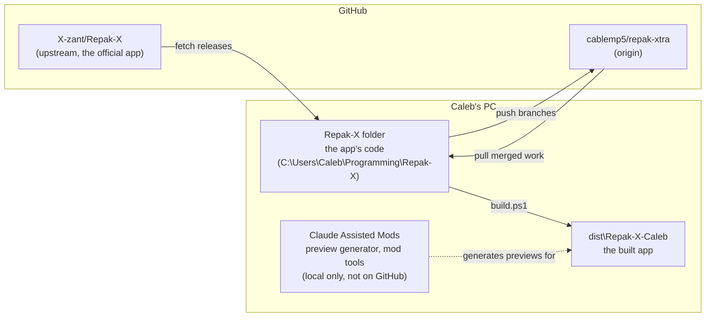
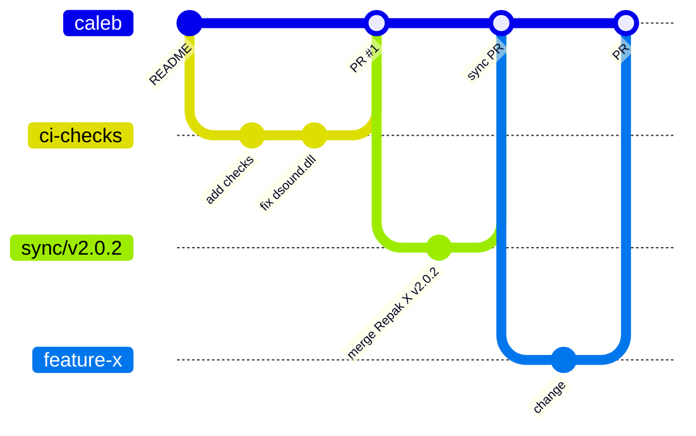
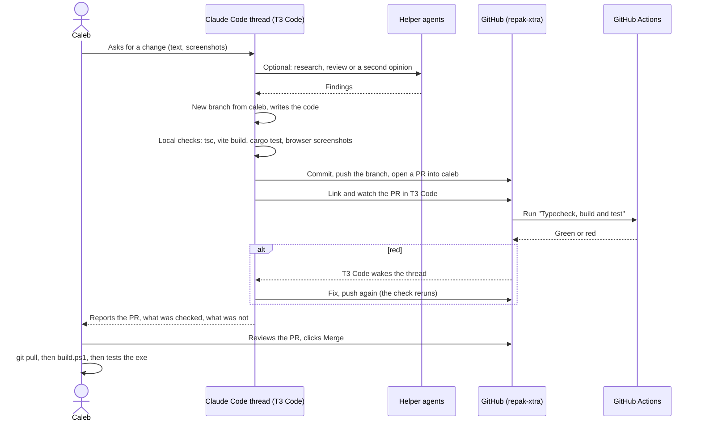
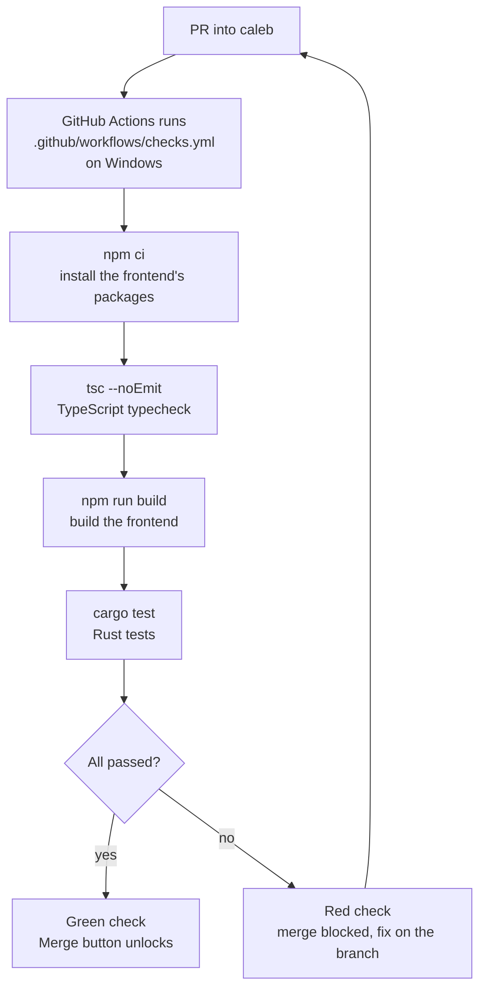
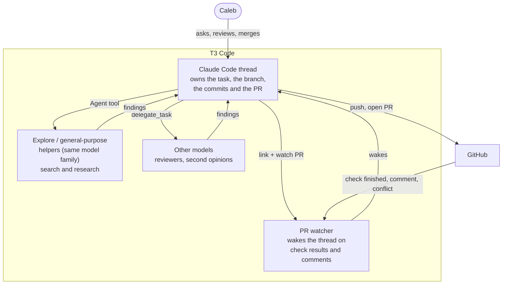
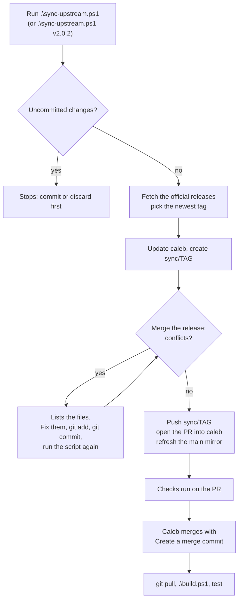
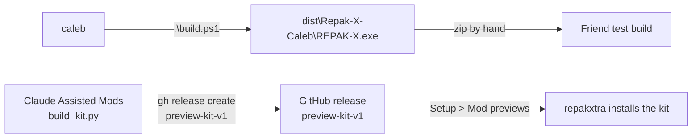

# How repakxtra is made

This page explains how changes to repakxtra travel from an idea to the app on your PC: the git branches, GitHub's pull requests and checks, and the AI agents that do most of the coding. If you only read one part, read [The short version](#the-short-version).

## Contents

1. [The short version](#the-short-version)
2. [Words used on this page](#words-used-on-this-page)
3. [Where everything lives](#where-everything-lives)
4. [Branches](#branches)
5. [How one change travels](#how-one-change-travels)
6. [The gate: checks and branch protection](#the-gate-checks-and-branch-protection)
7. [The agents](#the-agents)
8. [Pulling in Repak X updates](#pulling-in-repak-x-updates)
9. [Builds and releases](#builds-and-releases)
10. [Commands you will use](#commands-you-will-use)
11. [Rules](#rules)
12. [Not set up yet](#not-set-up-yet)

## The short version

- `caleb` is the main branch. It is protected: nobody, not even the repo owner, can push to it directly.
- Every change goes on its own branch and becomes a **pull request** (PR) into `caleb`.
- GitHub runs the **"Typecheck, build and test"** check on every PR. A PR can only merge when it is green.
- Claude Code (running in T3 Code) writes the code, opens the PR and watches the check. **Caleb clicks merge.**
- Updates from the official Repak X arrive the same way: `sync-upstream.ps1` opens a `sync/<tag>` PR.

## Words used on this page

| Word | Meaning here |
|---|---|
| **Repo** (repository) | The project folder plus its full history. The same repo exists on your PC and on GitHub. |
| **Commit** | One saved snapshot of changes, with a message saying what changed. |
| **Branch** | A named line of commits. Work happens on a side branch so `caleb` stays working. |
| **Remote** | A copy of the repo somewhere else. `origin` is your GitHub repo, `upstream` is the official Repak X. |
| **Push / pull** | Push sends your commits to GitHub. Pull brings GitHub's commits to your PC. |
| **Pull request (PR)** | A request on GitHub to merge one branch into another. It shows the changes and the check results. |
| **Check** | An automatic test GitHub runs on a PR, using GitHub Actions (free for public repos). |
| **Merge** | Bringing a branch's commits into another branch. |
| **Agent** | An AI model working on the code: the main Claude Code thread, or a helper it starts. |

## Where everything lives

- **cablemp5/repak-xtra** is public. Its default branch is `caleb`.
- **X-zant/Repak-X** is the official project. repakxtra never pushes or opens PRs there.
- **Claude Assisted Mods** holds the preview generator (`tools\previews`) and the preview kit builder. It has its own git history on your PC and is not pushed anywhere. Its commits start with `repo:`.

## Branches

| Branch | What it is | Who writes to it |
|---|---|---|
| `caleb` | The real app. Every build and release comes from here. | Only merged PRs |
| `main` | An exact copy of the official Repak X `main`. Never edited by hand. | `sync-upstream.ps1` |
| `sync/<tag>` | One official Repak X release merged on top of `caleb`. | `sync-upstream.ps1` |
| any other name | One change or fix, for example `ci-checks` or `docs-workflow`. Deleted after merging. | The agent working on it |

One branch per change keeps PRs small, so a failing check points at one thing.

## How one change travels

Step by step:

1. **Ask.** Describe the change in a T3 Code thread. Screenshots with drawn marks work well.
2. **Branch.** The agent starts a branch from the newest `caleb` (`git switch -c <name> origin/caleb`).
3. **Code.** New features go in repakxtra's own files (`repak-x/src/custom/`, `repak-x/src/caleb_*.rs`). Official Repak X files only get short hooks marked `// caleb fork:`, so upstream updates merge cleanly.
4. **Check locally.** TypeScript typecheck, frontend build, Rust tests, and for UI changes screenshots of the app running in a browser on fake data (`npm run dev` in `repak-x`).
5. **Commit.** Messages start with `caleb fork:` and say what changed for the user. Each commit only lists the files that agent changed.
6. **Push and open the PR** into `caleb` on `cablemp5/repak-xtra`. The PR body says what changed, how it was checked and what was not.
7. **Watch.** The thread links the PR in T3 Code and watches it. When the check finishes or someone comments, T3 Code wakes the thread. A red check gets fixed on the same branch.
8. **Merge.** Caleb reads the PR and clicks merge (see [which merge button](#which-merge-button)).
9. **Get it on your PC.** `git switch caleb`, `git pull`, then `.\build.ps1`, then test the app.

## The gate: checks and branch protection

The check takes 6 to 9 minutes. It also runs after every merge into `caleb`, so the branch's own state is always visible on GitHub.

Branch protection on `caleb` (Settings > Branches on GitHub):

| Rule | Setting |
|---|---|
| Changes need a pull request | On, 0 approvals needed (Caleb merges his own PRs) |
| Required check | "Typecheck, build and test" |
| Applies to admins | On, so the owner cannot skip it by accident |
| Force push | Blocked |
| Deleting the branch | Blocked |

The check already caught one real bug before any release: CI copies of the repo got a small text placeholder in place of the bundled signature bypass DLL (Git LFS stores `*.dll` files separately), and the app would have shipped that placeholder. `.gitattributes` now stores that one DLL as a normal file.

### Which merge button

| PR | Button | Why |
|---|---|---|
| A normal change | **Squash and merge** | The branch becomes one tidy commit on `caleb`. |
| A `sync/<tag>` PR | **Create a merge commit** | Git must remember that the official release is merged, or the next sync brings the same changes again and conflicts. |

After merging, click **Delete branch** on the PR page.

## The agents

How the work is split:

- **One thread owns one task.** That thread is the only one that commits, pushes and opens the PR for it. Helpers report back; they do not commit.
- **Helpers** read and search widely so the main thread keeps only the conclusion. Typical jobs: find where something is handled, review a diff, check a library's current documentation.
- **Joint reviews** for bigger changes: two reviewer models read the code, compare notes and agree on a plan; one model then implements the plan as normal PRs.
- **What the agents know** comes from instruction files (`CLAUDE.md`), their notes about this project, and the code itself. Rules like "never push to `caleb`" are written there, and branch protection enforces the important ones anyway.
- **Parallel threads** are fine for separate tasks on separate branches. Two threads must not edit the same files at the same time: they share one folder on the PC (no git worktrees yet).

What agents always do:

- Start from the newest `caleb`, one branch per task.
- Run the local checks before pushing and say which ones ran.
- Report results with evidence (check output, screenshots), and tag claims about the game as unverified until Caleb tests in game.
- Leave the merge to Caleb unless he asks otherwise.

## Pulling in Repak X updates

Running it again after fixing conflicts picks up the same `sync/<tag>` branch and finishes the job. It needs the GitHub CLI (`gh`) to be logged in.

## Builds and releases

**Today:**

- `.\build.ps1` builds the app on your PC, the same steps as the official release workflow. It alternates between `dist\Repak-X-Caleb` and `dist\Repak-X-Caleb-next`, so a running copy never blocks a build. The desktop shortcut always opens the newest build.
- Test builds for friends are zipped by hand from `dist`.
- The **preview kit** is a separate download. It is published as a GitHub release tagged `preview-kit-v<N>`, and the app's Setup panel installs it from there. It is built in Claude Assisted Mods (`tools\previews\build_kit.py`). Publishing it is Caleb's decision only.

## Commands you will use

| Goal | Command (PowerShell, in the Repak-X folder) |
|---|---|
| See which branch you are on and what changed | `git status` |
| Get merged work onto your PC | `git switch caleb` then `git pull` |
| Build the app | `.\build.ps1` |
| List open PRs | `gh pr list` |
| Open a PR in the browser | `gh pr view 3 --web` |
| See a PR's checks | `gh pr checks 3` |
| Bring in the newest Repak X release | `.\sync-upstream.ps1` |
| Remove local branches that were merged | `git fetch --prune` then `git branch --merged caleb` and `git branch -d <name>` |

## Rules

- Never push straight to `caleb`, never force push. (GitHub blocks both anyway.)
- Never commit secrets: the Sigeon license key, the transitions.dev key, or the preview kit zip (it contains the game's AES key).
- Never commit game files or build output (`dist\`, `target\`).
- Commit only the files you changed, by name. No `git add -A` or `git add .`.
- No destructive git commands (`reset --hard`, `clean`, `stash`, `checkout .`) without Caleb's OK.
- Nothing is published (releases, uploads) without Caleb's OK.

## Not set up yet

Planned, in this order, each only when Caleb asks:

1. **Issues:** write bugs and ideas as GitHub issues so each PR closes one (`Fixes #12` in the PR body).
2. **Releases:** build and publish the app from GitHub Actions on a version tag, and point the app's self-updater at cablemp5/repak-xtra (it still points at the official Repak X, so it is turned off).
3. **Parallel work:** split `caleb.css` by feature and allow git worktrees for this repo, so several agents can work at once without touching the same files.
4. **Automation:** hooks that run the checks before every push, and a review agent that comments on each PR.

Known gap: the official `release.yml` workflow came with the fork. It runs on pushes to `main` whose commit message contains `[run-ci]`, and `sync-upstream.ps1` pushes the official `main` there, so an official commit with that tag could build and publish a release on this repo. Step 2 replaces it.
